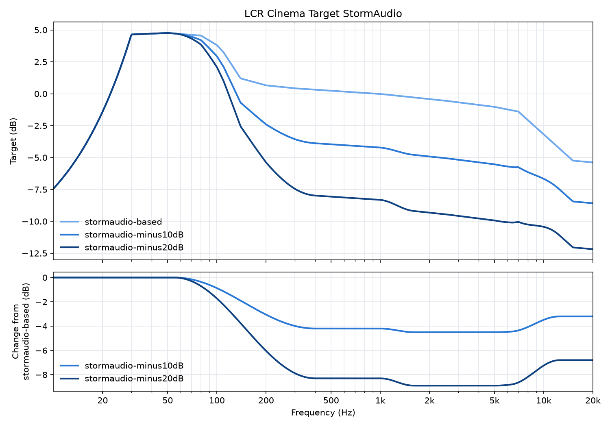

# Dirac Live target curves for listening below reference level

This repo holds three packages of Dirac Live target curves. Each package is one folder in `targets/`, with one curve per speaker group: LCR, Surround, Surround Back, Atmos-Height and Subwoofer. Load each package into its own receiver preset, then pick the preset that matches how loud you listen.

The first package, `stormaudio-based`, is for cinema reference level (0 dB on a receiver calibrated to the film standard). It starts from the Dirac Live targets published by StormAudio, a maker of home-theater processors. The other two packages are for listening about 10 dB and 20 dB below reference. At lower volume the ear hears less deep bass and less of the highest treble, and becomes slightly more sensitive to the upper midrange. The quieter packages raise the bass and treble relative to the midrange, and lower the upper midrange slightly.

| Receiver preset | Package (folder in `targets/`) | Use when listening at | Bass at 50 Hz vs midrange | Treble above 12.5 kHz vs midrange |
|---|---|---|---|---|
| 1 | `stormaudio-based` | reference | as StormAudio | as StormAudio |
| 2 | `stormaudio-minus10dB` | about 10 dB below reference | +4.2 dB | +1.0 dB |
| 3 | `stormaudio-minus20dB` | about 20 dB below reference | +8.3 dB | +1.5 dB |



## Installing the curves

Copy the three folders from `targets/` to the computer that runs Dirac Live. In each Dirac Live preset, load the file for each speaker group from the matching folder, then run the filter design.

## Setting the volume

The quieter packages lower the midrange, so you raise the volume to bring dialogue back to the same level. Set the master volume to the level you want, in dB from reference, plus the offset for your preset, shown in the Reference row of the table. The offsets are the midrange cuts of 4.2 and 8.3 dB. The table rounds them to the nearest 0.5 dB, because many receivers change volume in 0.5 dB steps.

| Level you want | Preset 1 | Preset 2 | Preset 3 |
|---|---|---|---|
| Reference (0) | 0.0 | +4.0 | +8.5 |
| −10 | −10.0 | −6.0 | −1.5 |
| −20 | −20.0 | −16.0 | −11.5 |

This table assumes that 0 dB on your receiver is calibrated reference level, and that Dirac uses each curve at the level it is drawn (see "What has not been checked in Dirac Live"). To measure the real offsets, play pink noise limited to the midrange (for example 500 Hz to 1 kHz) on preset 1 and note the reading on an SPL meter at your seat. Switch to preset 2 or 3 and raise the volume until the meter shows the same reading. The amount you raised it is the real offset for that preset.

Preset 3 at reference dialogue level needs +8.5 on the volume dial. At that setting the bass plays about 8.5 dB louder than it does on preset 1 at reference. Use preset 3 only when you listen about 20 dB below reference.

## How the curves are built

`stormaudio-based` holds StormAudio's cinema targets with the owner's own changes to the correction limits. It also has a dip of about 2.6 dB near 2.2 kHz on the Surround and Surround Back curves, which the owner added as midrange compensation because those surround speakers are lower-end models. `tools/build.py` makes the two quieter packages from it:

- **The bass shelf lifts the low end.** Below 55 Hz the shelf adds a fixed amount. Above that it fades out smoothly and reaches zero at 400 Hz. Both packages use the same fade, so package 2's lift is half of package 3's at every frequency. The fixed amount is the extra level that ISO 226:2003, the standard for equal-loudness contours, says the ear needs at 50 Hz. `tools/iso226.py` calculates it from the standard's table. Below 50 Hz the shelf stays at the 50 Hz amount. From 80 to 100 Hz it adds up to about 0.7 dB more than the standard. Above that it adds less: at 200 Hz package 3 adds 2.3 dB where the standard asks for 3.9 dB. The lift falls to half near 150 Hz, where Dirac Live ART stops working, so the full lift stays in the range where ART controls how long bass rings, and voices get less of it.
- **The treble shelf lifts the top octave a little.** It fades in from 6.3 kHz and reaches its full amount at 12.5 kHz: 1.0 dB for package 2 and 1.5 dB for package 3. ISO 226 asks for 1.7 and 3.3 dB at 12.5 kHz. The owner counts on StormAudio's treble rolloff to prevent listening fatigue, and the smaller lift keeps most of it: from 1 kHz to 16 kHz the base curve falls 5.3 dB, package 2 falls 4.3 dB and package 3 falls 3.8 dB. A larger lift can make the treble rise again above 8 kHz, a peak that StormAudio's rolloff doesn't have. `tools/check.py` fails if any curve's treble rises above 4 kHz.
- **The presence dip lowers the upper midrange slightly.** ISO 226 says that at lower volume the ear becomes relatively more sensitive from about 1.25 to 6.3 kHz. The build cuts 1.6 to 5 kHz by 0.3 dB (package 2) or 0.6 dB (package 3), the amounts ISO 226 gives there. The cut fades in from 1 kHz and fades out by 12.5 kHz. A faster fade-out makes the treble rise near 6.4 kHz.
- **The changes are then turned into cuts.** After adding the shelves and the dip, the build lowers the whole curve by the bass amount. Dirac allows more cutting than boosting relative to the measured room response, so a curve made only of cuts is less likely to run into the boost limit. Lowering the whole curve leaves its shape unchanged and changes only the volume you need, as the section on setting the volume explains.
- **Every speaker group gets the same change.** Dirac Live ART (Active Room Treatment) treats all speakers as one system, and several speakers work together on each bass note. If the groups got different changes, their curves would ask for different bass levels from speakers that are playing the same notes. Giving every group, including the subwoofer, the same change keeps their levels relative to each other the same as in `stormaudio-based`.

The build adds a breakpoint every 1/24 octave inside each fade. Outside the fades, the curves keep the breakpoint frequencies of `stormaudio-based`.

## Rebuilding or changing the curves

You need [uv](https://docs.astral.sh/uv/), a tool that runs Python projects. On first run it installs Python. It also installs the two libraries the tools need, numpy and matplotlib.

```sh
make build      # rebuild targets/stormaudio-minus10dB and targets/stormaudio-minus20dB
make check      # check the built curves against hand-written expected values
make selftest   # confirm the checker rejects an unmodified package
make plot       # redraw docs/curves.png (LCR) and docs/subwoofer.png
```

The numbers that shape the curves are at the top of `tools/build.py`. `gb` is the bass lift, `gt` the treble lift and `gp` the presence dip. `f1` and `f2` are where the bass fade starts and ends. `tools/targetcurve.py` reads `.targetcurve` files and works out the level between breakpoints for the builder and the plot.

`tools/check.py` imports nothing from the other tools. It has its own file reader and its own copy of the expected numbers. A bug in `targetcurve.py` or `build.py` therefore shows up as a difference from those numbers. When you change the build numbers, three other things change with them:

- The expected values in `tools/check.py`. Update `GB` to the new `gb`. In `PKGS`, the values at 31 Hz and 50 Hz equal `gb`, and the values at 12.5, 16 and 20 kHz equal `gt`, and the values at 2, 3 and 4 kHz equal minus `gp`. The values at 100, 140 and 200 Hz and at 1.25, 6.3, 8 and 10 kHz come from `fade()` in `build.py`, so compute them with it.
- The volume offsets in the table under "Setting the volume". Each equals `gb` rounded to 0.5 dB.
- The match with the standard at 100 Hz. Changing `gb` without moving `f1` and `f2` moves the 100 Hz lift away from ISO 226.

`uv run tools/iso226.py 85 10 20` prints the extra level ISO 226 asks for at each frequency when you listen 10 dB and 20 dB below 85 phon. A phon is a unit of how loud a sound seems, and 85 phon sounds as loud as a 1 kHz tone at 85 dB SPL. The build takes 85 phon as cinema reference level. Change the numbers to try another reference level or volume drop.

## Choosing how much compensation to use

At 50 Hz these packages add the full amount ISO 226 calls for. In the treble they add less, to keep StormAudio's rolloff. Other products and research suggest that the full amount may be more than some listeners want:

- Audyssey Dynamic EQ assumes by default that content was mixed at film reference level. Denon recommends a 10 dB offset for TV and jazz, because TV is usually mixed 10 dB below film reference, and a 15 dB offset for pop and rock ([Denon manual](https://manuals.denon.com/AVRS950h/NA/EN/GFNFSYphwaueoj.php)). The manual does not say how much bass or treble Dynamic EQ adds. Its offsets show that Audyssey changes the amount according to how loud the content was mixed. TV and pop are mixed louder relative to their playback level than film, so with that content the full amount may sound too heavy.
- Simple Home Cinema measured Yamaha's YPAO Volume. It added about 1 dB of bass and 1 dB of treble for every 5 dB the volume dropped below the reference setting the article's author chose on his receiver ([measurement](https://simplehomecinema.com/2017/08/05/loudness-correction-and-yamaha-ypao-volume/)). At 10 dB down that comes to about 2 dB each. That is about half of package 2's 4.2 dB of bass and about twice its 1.0 dB of treble.
- Holman and Kampmann studied loudness controls in 1978 and wrote that "most of them overcompensate" (J. AES 26(7/8), [abstract](https://aes.org/publications/elibrary-page/?id=3261)).

[docs/bass-review.md](docs/bass-review.md) sums up independent reviews of the bass, and what to try, in order, if preset 3 sounds boomy. If the quieter presets sound too heavy, start by lowering `gb` and `gt`. In that case you are leaving the standard on purpose, so there is no 100 Hz match to keep.

## What has not been checked in Dirac Live

- Whether Dirac uses a curve at the level it is drawn. The volume table depends on it.
- How Dirac draws a curve between breakpoints. The 1/24-octave breakpoints keep the fades within 0.01 dB of their intended shape whether it draws straight lines or a smooth curve.
- Whether the curves load on receivers other than the Denon AVR-X3800H. The four speaker files are tagged with that device name, and the Subwoofer file with `isp-host`.

## How you may reuse this

Everything in this repo except `targets/` is under the MIT License (see `LICENSE`). The curves in `targets/` are based on StormAudio's published Dirac Live targets. That license does not cover StormAudio's rights in them.
